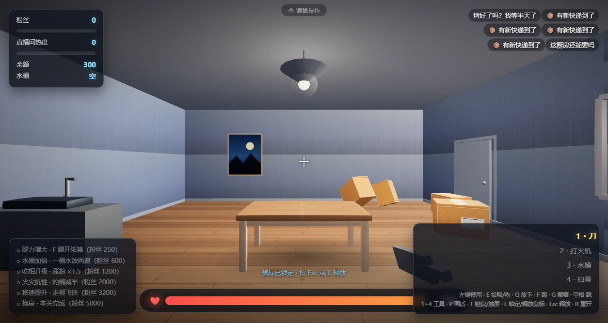

# 深夜吃播 · 快递开箱 (Midnight Mukbang)

一个跑在浏览器里的第一人称 3D 吃播游戏：粉丝不断寄来快递，你要拆箱、生火烤肉、吃掉涨粉——同时小心别把自己和房子一起点了。

**纯前端、单文件夹、离线可玩**：双击 `index.html` 就能开始，不需要服务器、不需要构建、不联网。



## 特性

- **第一人称操作**：WASD 移动、空格跳跃、能跳上快递箱/餐桌/沙发，甚至跳上箱塔
- **刚体物理**：基于 cannon.js，快递箱会自由落体、互相碰撞、**叠放**，重心偏出支撑面就会倒下；踢一脚会翻滚着飞出去
- **像素风火焰**：16×16 像素火 + NearestFilter，**从箱顶 → 四周 → 整体**逐级爬升，烧到一定程度会**点燃地板**形成地面火
- **食物系统**：8 种食材（五花肉、牛排、鸡腿、披萨、烧烤串、鱼、土豆、玉米），生火烤制，**生 → 熟 → 糊**三段颜色 + 恰好熟时泛金色微光
- **火灾双刃**：火同时产生热度收益（涨粉）、赔付成本、以及对你本人的灼烧伤害
- **消防车事件**：火真的失控了才会招来消防车（热度 + 燃烧时长 + 多团火），窗外开来消防车、**水柱穿过窗户**逐处灭火，室里**逐渐灌水**，火灭后慢慢退去
- **房屋扩建**：粉丝达标后房间真的变大（地板/墙体/碰撞体重建），并添置新家具（冰箱、书架、绿植）
- **弹幕/观众**：按局面分组的弹幕池（闲聊、开箱、烤制、起火、火大、糊了、刚灭火、灌水、满地灰、血少……），
  只在"符合当前情况"时才播，还带观众昵称和随机礼物；事件提示做了节流，不会刷屏
- **消防车门控**：热度够高 **且** 火烧够久 **且** 现场真失控（多团火 / 家具 / 地面火）才会破门——点一把小火不会被消防车追着跑
- **细节**：快递箱烧尽后**化为灰烬**，可用**扫帚**扫掉换打赏；接触阴影、程序化材质、暗角与颗粒后期

## 操作

| 键 | 作用 |
| --- | --- |
| `W A S D` | 移动 |
| `Shift` | 加速跑 |
| `空格` | 跳跃 |
| `鼠标` | 视角（点击画面锁定，`Esc` 或 `L` 释放） |
| `1` / `2` / `3` / `4` | 刀 / 打火机 / 水桶 / 扫帚 |
| `左键` | 使用当前工具 |
| `E` | 拾取 / 吃掉 / 在水槽边接水 |
| `Q` | 放下手中的食材 |
| `F` | 踢开箱子（需解锁腿力） |
| `G` | 搬起 / 放下箱子 |
| `P` | 切换画质（高/中/低） |
| `T` | 手动切换「键鼠 / 触屏」操作（一般不用管，会自动识别） |
| `R` | 重开 |

## 快速开始

```bash
git clone <this-repo>
cd <repo>
# 直接双击 index.html，或者：
start index.html      # Windows
open index.html       # macOS
```

不需要 `npm install`，没有构建步骤。


## 手机上也能玩

**输入方式自动识别**：电脑打开就是键盘鼠标，屏幕上不会冒出摇杆按钮；手机/平板打开自动切成触屏操作。

判据是「主指针是什么」：主指针是手指（`pointer: coarse` / `hover: none`）走触屏，主指针是鼠标或触控板走键鼠。
所以 **Windows 触屏笔记本不会被误判**——它有触屏，但主指针还是触控板/鼠标，依旧按键盘操作，摇杆不会冒出来。

触屏操作（横屏体验最佳）：

- **左下虚拟摇杆**：走路（推动摇杆即前进/后退/左右平移）
- **滑动屏幕**：转动视角
- **右侧按钮**：「使用」（按住可连续切箱/点火）、「拿/吃」、「跳」、「换工具」（刀→打火机→水桶→扫帚循环）、「放下」、「踢」、「搬箱」
- 触屏模式会自动把画质降到「低」档（关阴影、像素比 1）以保证帧率，也不使用鼠标指针锁定
- 触屏控件只在开播后出现，一局结束自动收起；触屏笔记本真用手指戳屏幕时，顶部胶囊会闪一下提示

想手动切换：点屏幕顶部的小胶囊（🖱 键鼠操作 / 📱 触屏操作），或按 `T`。选择记在 `localStorage`（键 `mukbang.inputMode`），
下次打开照旧；想恢复自动识别就把它删掉。

## 技术说明

- **渲染**：Three.js r149（UMD，本地引入），ACES 色调映射、PCF 软阴影
- **物理**：cannon.js 0.6.2，箱体为动态刚体，墙体/家具/地面为静态体
- **贴图**：**全部程序化生成**（canvas 现画）。这不是偷懒——游戏用 `file://` 打开时浏览器会把本地图片判定为跨域，WebGL 上传贴图会抛安全错误，因此程序化生成反而是这类单文件项目的正确解法
- **性能**：火焰点光源使用固定池（最多 2 盏），像素火全部为 alphaTest 平面；画质可按 `P` 降档

## 自动化测试

`tests/` 目录下是基于 CDP 的无头浏览器测试，覆盖物理、跳跃、烤制、火焰扩散、消防车/灌水、房屋扩建、灰烬与扫帚、手机触屏、输入方式识别、弹幕语境与消防车门控等 16 个套件、约 120 项断言。

```bash
# 先启动一个带调试端口的浏览器（示例）
# msedge --headless=new --remote-debugging-port=9333 "file:///<path>/index.html"
node tests/_test13_physics.mjs 9333
node tests/_test22_inputmode.mjs 9333   # 电脑 / 触屏笔记本 / 手机三种设备下的输入方式识别
node tests/_test23_danmaku.mjs 9333     # 弹幕是否跟着局面走 + 消防车不会一来就上门
```

## 第三方

- [Three.js](https://threejs.org/) — MIT
- [cannon.js](https://github.com/schteppe/cannon.js) — MIT

许可与版权声明见 `THIRD_PARTY.md`。

## 许可

MIT，详见 `LICENSE`。
